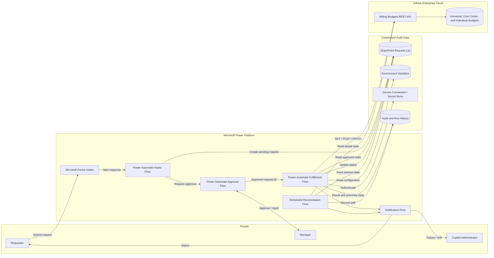
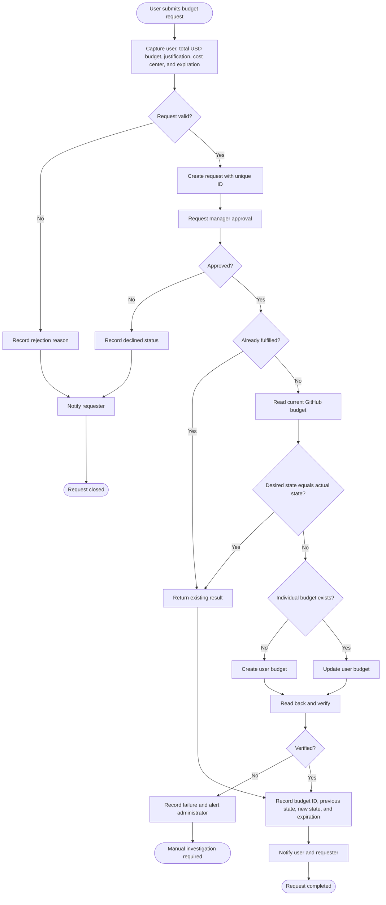
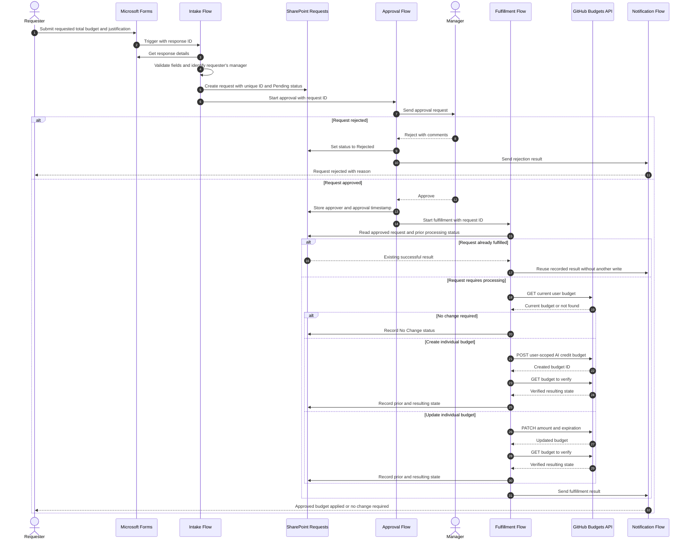

# AI Credit Budget Automation Architecture

This document describes a proposed Power Platform architecture for requesting,
approving, applying, and reconciling individual GitHub Copilot AI credit
budgets.

## 1. Solution architecture

### Component responsibilities

| Component | Responsibility |
|---|---|
| Microsoft Forms | Collects the initial request |
| Intake flow | Validates fields and creates a tracked request |
| SharePoint list | Stores desired state, approval status, and processing result |
| Approval flow | Routes each valid request to the requester's manager |
| Fulfillment flow | Creates or updates the GitHub individual budget |
| Reconciliation flow | Compares approved requests with GitHub's actual state |
| Notification flow | Sends success, rejection, failure, and expiration notices |
| Environment variables | Store non-secret configuration |
| Secure connection | Protects the GitHub API credential |
| Audit history | Records previous state, resulting state, actor, and outcome |

## 2. Request and approval flow

Every valid request requires one approval from the requester's manager. The
requested budget amount does not change the approval route.

## 3. Request fulfillment sequence

## 4. Suggested implementation phases

### Phase 1: Intake and approval

- Microsoft Forms
- SharePoint request list
- Intake validation flow
- Approval flow
- Approval and rejection notifications
- Manual GitHub fulfillment by an administrator

The administrator records the GitHub budget ID and result in SharePoint.

### Phase 2: Automated fulfillment

- GitHub REST API custom connector
- Current-budget lookup
- Automated budget creation and updates
- Read-after-write verification
- Idempotency controls
- Failure notifications

### Phase 3: Governance

- Scheduled reconciliation
- Expiration reminders
- Drift reporting
- Operational dashboard
- Cost-center reporting
- Controlled automatic cleanup

This phased approach allows AVEVA to deliver the intake and approval process
without waiting for GitHub API authentication and production automation to be
completed.
